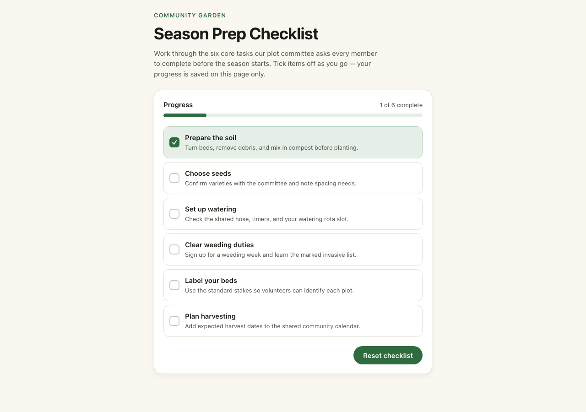

# Brainbaby App Builder Examples

A working AI app builder example you can inspect, run and change. Start with a small React checklist, compare its behavior with the brief, then use the same checks on your own app idea.

This collection currently contains **one verified example**. It was built in [Brainbaby](https://brainbaby.ai/web-apps?utm_source=github&utm_medium=referral&utm_campaign=app-builder-example), reopened in the product, exported, and built separately from the downloaded source. It is an owned QA example, not a customer case study or a benchmark against other builders.

## Try the app first

**[Open the live checklist](https://brainbaby.ai/examples/garden-checklist)** — no account or purchase is needed to use this example.

Tick the six tasks, watch the count change, complete the list and reset it. Progress is local to the open page and clears on reload. The example has no account, database, payments or external service.



## What's included

| Resource | What you can check |
| --- | --- |
| [React source](examples/garden-checklist) | Components, local state, task data and styling |
| [Original export ZIP](downloads/garden-checklist-original.zip) | The unchanged file downloaded from Brainbaby |
| [Brief and evaluation workflow](docs/build-and-evaluate.md) | The instruction used for this app and checks for your own version |
| [File provenance](docs/garden-checklist-provenance.json) | Original file hashes and the scope of the verification |

The 13 files inside the original export are unchanged. The example folder also includes the lockfile from the independent verification build. Repository documentation, this screenshot and the integrity checker are separate additions.

## Run the React example locally

Use a supported Node.js LTS release with npm. From this repository:

```sh
cd examples/garden-checklist
npm ci
npm run dev -- --host 127.0.0.1
```

Open the local URL printed by Vite. Keep the development server on your own machine.

To build the frontend:

```sh
npm run build
```

From the repository root, check the original export's integrity with:

```sh
node tools/verify-export.mjs
```

The original ZIP does not contain a lockfile. Use the checked-in example folder if you want the recorded dependency resolution.

## Evaluate an AI app builder with a real task

A useful first project has one action you can test. In this example, that action is checking a task and resetting the list. Before making a project larger, check:

1. **Behavior:** does the control change the intended state?
2. **Recovery:** what happens when you reload? This example deliberately resets.
3. **Accessibility:** can you use the controls with a keyboard and read their labels?
4. **Layout:** does the page fit a phone and desktop without horizontal scrolling?
5. **Handoff:** can you download the source and build it outside the original tool?

The [evaluation workflow](docs/build-and-evaluate.md) explains how to extend those checks when an app needs saved records, user accounts or payments. Those features are not implemented in this example.

## Build your own version with Brainbaby

**[Prepare your own app brief](https://brainbaby.ai/web-apps?utm_source=github&utm_medium=referral&utm_campaign=app-builder-example&utm_content=build-your-own).** Start with the user, the task and one working action. Ask for a small revision, inspect the result, and repeat the relevant checks.

Trying this example and downloading its source are free. Generating or revising your own Brainbaby project requires account access and the allowance shown for that action. [Review the current builder plans](https://brainbaby.ai/pricing?return_to=websites); credits are usage allowances, not a guaranteed number of finished apps. Hosting, third-party services and native store submission have their own requirements.

## Questions and scope

Open a GitHub issue for a problem with these example files or their instructions. Use fictional information when describing a problem; do not post credentials, customer data or private projects.

This repository does not add a new open-source license to the original export or third-party dependencies. Existing rights and dependency licenses remain as supplied. Brainbaby branding is not a license to imply affiliation or endorsement.
